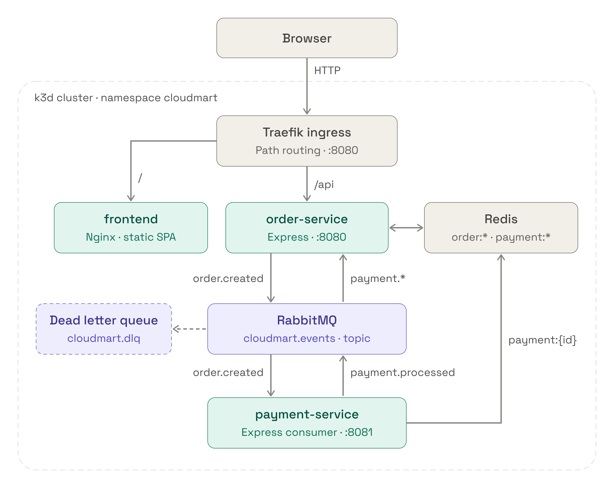

# CloudMart Kubernetes Microservices Platform

A cloud-native e-commerce platform demonstrating event-driven microservices architecture deployed on **Kubernetes (k3d)** with **ArgoCD GitOps**, **Sealed Secrets**, **GitHub Actions CI/CD**, and an observability pipeline powered by **kube-prometheus-stack**. Built to explore Kubernetes patterns, Helm, RabbitMQ, Redis, automated deployment pipelines, and microservice choreography.

---

## 🏗️ Architecture Overview



### Event Flow (Choreography Pattern)

| Event | Publisher | Consumer | Routing Key | Description |
|-------|-----------|----------|-------------|-------------|
| `order.created` | order-service | payment-service | `order.created` | New order placed, triggers payment processing |
| `payment.processed` | payment-service | order-service | `payment.processed` | Payment completed (success/failed), updates order status |
| `payment.*` | payment-service | order-service | `payment.*` | Wildcard binding for all payment events |

---

## 📦 Services & Components

### 1. **frontend** (nginx)
- **Technology**: Nginx serving static HTML/CSS/JS
- **Port**: 80 (internal), 8080 (via Ingress)
- **Features**:
  - Product catalog with add-to-cart
  - Real-time transaction monitor
  - Live order status polling
  - Responsive design with custom CSS

### 2. **order-service** (Node.js/Express)
- **Technology**: Express.js, amqplib, ioredis
- **Port**: 8080
- **Endpoints**:
  - `POST /api/orders` — Create order (returns 202 Accepted, async)
  - `GET /api/orders/:id` — Check order status
  - `GET /healthz` — Kubernetes liveness/readiness probe
- **Behavior**:
  - Stores order in Redis (`order:{id}`)
  - Publishes `order.created` event to RabbitMQ
  - Consumes `payment.*` events to update order status

### 3. **payment-service** (Node.js/Express)
- **Technology**: Express.js, amqplib, ioredis
- **Port**: 8081 (health only, internal service)
- **Endpoints**:
  - `GET /healthz` — Kubernetes probe
- **Behavior**:
  - Consumes `order.created` from queue `orders.process-payment`
  - Simulates payment gateway (100ms latency)
  - Stores payment audit in Redis (`payment:{id}`)
  - Publishes `payment.processed` event
  - **Dead Letter Queue (DLQ)** configured for poison message handling

### 4. **traffic-generator** (Node.js/Express)
- **Technology**: Express.js, prom-client
- **Port**: 8082
- **Endpoints**:
  - `GET /metrics` — Prometheus metrics endpoint
  - `GET /healthz` — Health check probe
  - `POST /config` — Dynamically tune request rates (`requestsPerSecond`, ratios)
- **Behavior**:
  - Replays realistic user journeys (`browse` → `checkout` → `poll`) against the frontend and order service
  - Emits custom Prometheus metrics (`traffic_generator_http_requests_total`, `traffic_generator_http_request_duration_seconds`, `traffic_generator_active_sessions`, etc.) with scenario and target labels to exercise the observability stack

### 5. **Infrastructure & Platform**

| Component | Version / Type | Purpose |
|-----------|----------------|---------|
| **RabbitMQ** | 4.3.6 | Message broker (topic exchange, dead-letter exchange) |
| **Redis** | 7.0.11 | Order state cache + payment audit logs |
| **Traefik** | Ingress Controller | Path and host-based routing (apps & Grafana) |
| **ArgoCD** | GitOps Controller | Declarative continuous delivery, auto-sync, drift detection & self-healing |
| **Sealed Secrets** | Bitnami Controller | GitOps-safe encrypted secrets decrypted only in-cluster |
| **kube-prometheus-stack** | 93.3.0 | Prometheus Operator, node-exporter, kube-state-metrics, and Grafana |

---

## 🔄 GitOps & CI/CD Workflow

CloudMart is managed declaratively via GitOps and automated GitHub Actions workflows:

```
[ Developer Commit ] 
       │
       ▼ (push to main: services/**)
[ GitHub Action: Build Images ]
  ├── Build: frontend, order-service, payment-service, traffic-generator
  └── Push: ghcr.io/chamesh2019/<service>:<sha> & :latest
       │
       ▼ (manual or release trigger)
[ GitHub Action: Update Deployment Versions ]
  ├── Validates image tags in GHCR via docker manifest inspect
  └── Updates deploy/helm/k8s/values/<service>.yaml with new tag & commits to main
       │
       ▼ (polls or webhook)
[ ArgoCD GitOps Engine ]
  ├── App: cloudmart (deploy/helm/k8s) -> auto-sync + self-heal + prune
  └── App: monitoring (kube-prometheus-stack) -> values from main branch
```

### GitOps Application Manifests
- **CloudMart Platform**: `deploy/helm/argocd/cloudmart.yaml`
  - Deploys the modular Helm chart to the `cloudmart` namespace.
  - Features automated prune and self-healing.
- **Observability Stack**: `deploy/helm/prometheus-stack/observability.yaml`
  - Deploys `kube-prometheus-stack` into the `monitoring` namespace using multiple ArgoCD sources (upstream Helm chart + values committed in this repo).

---

## 🚀 Quick Start (k3d & ArgoCD)

### Prerequisites
- [Docker](https://docs.docker.com/get-docker/)
- [k3d](https://k3d.io/#installation)
- [kubectl](https://kubernetes.io/docs/tasks/tools/)
- [Helm](https://helm.sh/docs/intro/install/)
- [kubeseal](https://github.com/bitnami-labs/sealed-secrets#installation) (for updating SealedSecrets)

### 1. Create k3d Cluster
```bash
# Create cluster exposing ports 8080 (Ingress) and 8443
k3d cluster create cloudmart \
  --agents 2 \
  --servers 1 \
  -p "8080:80@loadbalancer" \
  -p "8443:443@loadbalancer"
```

### 2. Install Sealed Secrets Controller
```bash
helm repo add sealed-secrets https://bitnami-labs.github.io/sealed-secrets
helm repo update
helm install sealed-secrets-controller sealed-secrets/sealed-secrets -n kube-system
```

### 3. Install ArgoCD
```bash
kubectl create namespace argocd
kubectl apply -n argocd -f https://raw.githubusercontent.com/argoproj/argo-cd/stable/manifests/install.yaml

# Wait for ArgoCD server ready
kubectl wait --for=condition=available deployment/argocd-server -n argocd --timeout=300s
```

### 4. Deploy Applications via ArgoCD
Apply the ArgoCD application manifests to let GitOps take over:

```bash
# Deploy CloudMart application
kubectl apply -f deploy/helm/argocd/cloudmart.yaml

# Deploy Monitoring Stack (Prometheus + Grafana)
kubectl apply -f deploy/helm/prometheus-stack/observability.yaml
```

*(Optional: manual local installation with Helm without ArgoCD)*:
```bash
helm install cloudmart ./deploy/helm/k8s \
  -f deploy/helm/k8s/values/rabbitmq.yaml \
  -f deploy/helm/k8s/values/redis.yaml \
  -f deploy/helm/k8s/values/frontend.yaml \
  -f deploy/helm/k8s/values/order-service.yaml \
  -f deploy/helm/k8s/values/payment-service.yaml \
  -f deploy/helm/k8s/values/traffic-generator.yaml \
  -f deploy/helm/k8s/values/ingress.yaml \
  --namespace cloudmart --create-namespace
```

---

## 🌐 Access Endpoints

| Service | URL / Access Method | Credentials |
|---------|---------------------|-------------|
| **Frontend UI** | [http://localhost:8080](http://localhost:8080) | — |
| **Order API** | [http://localhost:8080/api/orders](http://localhost:8080/api/orders) | — |
| **Grafana** | Add `127.0.0.1 grafana.localhost` to `/etc/hosts` → [http://grafana.localhost:8080](http://grafana.localhost:8080) *(or port-forward `svc/prometheus-grafana -n monitoring 3000:80`)* | `admin` / `admin` |
| **ArgoCD UI** | `kubectl port-forward -n argocd svc/argocd-server 8443:443` → [https://localhost:8443](https://localhost:8443) | `admin` / retrieve initial password: `kubectl -n argocd get secret argocd-initial-admin-secret -o jsonpath="{.data.password}" \| base64 -d` |
| **RabbitMQ Management** | `kubectl port-forward -n cloudmart svc/cloudmart-rabbitmq-service 15672:15672` → [http://localhost:15672](http://localhost:15672) | Decrypted via SealedSecret (`chames` / `chames`) |
| **Traffic Generator API** | `kubectl port-forward -n cloudmart svc/cloudmart-traffic-generator-service 8082:8082` → [http://localhost:8082/metrics](http://localhost:8082/metrics) | — |

---

## 🛠️ Project Structure

```
k8s-microservices/
├── AGENT.md                                # Agent operation guidelines
├── README.md                               # Project documentation
├── cloudmart_architecture.png              # Architecture diagram
├── .github/
│   └── workflows/
│       ├── deploy-to-ghcr.yaml             # Builds & pushes service containers to GHCR
│       └── update-manifests.yaml           # Validates tags & updates Helm values in Git
├── deploy/
│   └── helm/
│       ├── argocd/
│       │   └── cloudmart.yaml              # ArgoCD Application for CloudMart platform
│       ├── prometheus-stack/
│       │   ├── observability.yaml          # ArgoCD Application for kube-prometheus-stack
│       │   └── monitoring-values.yaml      # Custom Prometheus & Grafana values
│       └── k8s/                            # Modular Helm chart
│           ├── Chart.yaml
│           ├── values/                     # Split values per service
│           │   ├── frontend.yaml
│           │   ├── order-service.yaml
│           │   ├── payment-service.yaml
│           │   ├── traffic-generator.yaml
│           │   ├── rabbitmq.yaml
│           │   ├── redis.yaml
│           │   └── ingress.yaml
│           └── templates/
│               ├── ingress.yaml
│               ├── frontend-deployment.yaml
│               ├── frontend-service.yaml
│               ├── order-deployment.yaml
│               ├── order-service.yaml
│               ├── payment-deployment.yaml
│               ├── payment-service.yaml
│               ├── traffic-generator-deployment.yaml
│               ├── traffic-generator-service.yaml
│               ├── rabbitmq-deployment.yaml
│               ├── rabbitmq-service.yaml
│               ├── rabbitmq-sealed-secrets.yaml # Encrypted Bitnami SealedSecret
│               ├── redis-deployment.yaml
│               └── redis-service.yaml
└── services/
    ├── frontend/                           # Nginx static site
    │   ├── Dockerfile
    │   ├── nginx.conf
    │   └── src/
    ├── order-service/                      # Express.js order processing API
    │   ├── Dockerfile
    │   ├── package.json
    │   └── server.js
    ├── payment-service/                    # Express.js async payment consumer
    │   ├── Dockerfile
    │   ├── package.json
    │   └── server.js
    └── traffic-generator/                  # Synthetic load generator & prom metrics
        ├── Dockerfile
        ├── package.json
        └── server.js
```

---

## 🔍 Production Patterns & Concepts Demonstrated

### 1. GitOps & Declarative Delivery
- **ArgoCD as Single Source of Truth**: All manifests, configurations, and Helm values are synchronized directly from GitHub.
- **Self-Healing & Drift Detection**: Manual `kubectl edit` changes are automatically reconciled and restored to the state declared in Git.
- **Multi-Source ArgoCD Applications**: Demonstrates consuming official third-party Helm charts alongside repository-managed `values.yaml` files.

### 2. Secrets Management with Sealed Secrets
- **GitOps-Safe**: RabbitMQ authentication credentials are encrypted using Bitnami's `kubeseal` utility into `SealedSecret` resources that can safely live in public source control.
- **In-Cluster Decryption**: The cluster-side Sealed Secrets controller decrypts the payload into a native Kubernetes `Secret` at runtime.

### 3. Reliability & Pod Hardening
- **Zero-Downtime Rolling Updates**: Configured with `strategy: RollingUpdate`, `maxUnavailable: 0`, and `maxSurge: 2` across application deployments.
- **Comprehensive Probes**: Liveness and readiness HTTP probes on all microservices prevent broken containers from serving live traffic.
- **Resource Constraints**: CPU and memory requests & limits strictly defined for all workloads to prevent noisy-neighbor starvation.

### 4. Microservices & Event Choreography
- **Decoupled Architecture**: Services interact asynchronously through RabbitMQ topics without a centralized orchestration engine.
- **Resilience**: RabbitMQ Dead Letter Exchange (DLX) configured to isolate and retain failed payment messages without blocking queues.

### 5. Observability & Synthetic Traffic
- **Synthetic User Journeys**: `traffic-generator` simulates active user browsing, checkout, and order status polling with tunable load.
- **Instrumentation**: Prometheus metrics collection via `prom-client` tracking latency histograms, request counters, and active session gauges labeled by scenario.

---

## 🧪 Testing the Flow

### 1. Place an Order
```bash
curl -X POST http://localhost:8080/api/orders \
  -H "Content-Type: application/json" \
  -d '{"items": [{"id": "gpu-4090", "qty": 1}], "userId": "user-123", "amount": 1599.99}'
```
Response: `202 Accepted` with `orderId` and `status: PENDING`

### 2. Check Order Status
```bash
curl http://localhost:8080/api/orders/<orderId>
```
Status transitions asynchronously: `PENDING` → `CONFIRMED` (or `FAILED`)

### 3. Tune Synthetic Traffic Generator
```bash
# Adjust synthetic traffic dynamically (e.g., 5 requests per second)
curl -X POST http://localhost:8082/config \
  -H "Content-Type: application/json" \
  -d '{"requestsPerSecond": 5, "checkoutRatio": 0.2}'
```

---

## 🧹 Cleanup
```bash
# If using ArgoCD
kubectl delete -f deploy/helm/argocd/cloudmart.yaml
kubectl delete -f deploy/helm/prometheus-stack/observability.yaml

# Delete k3d cluster
k3d cluster delete cloudmart
```

---

## 📄 License

This project is for **educational/learning purposes only**. No warranty provided.
